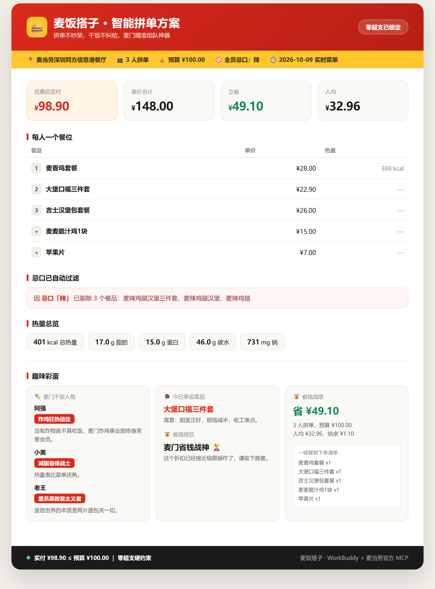
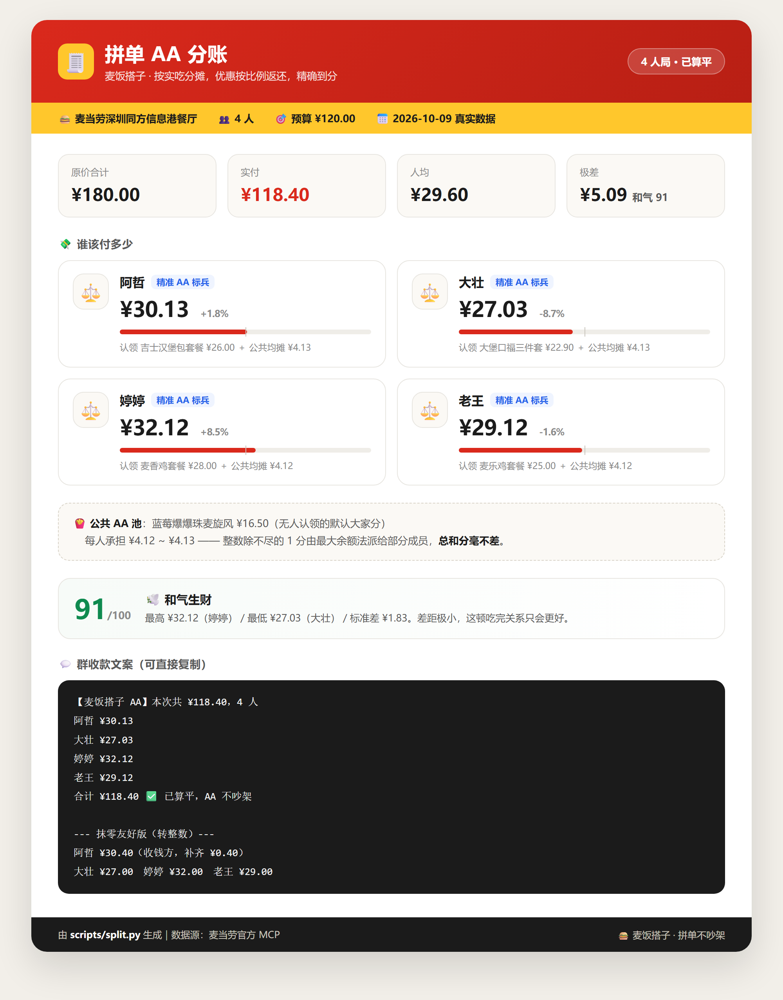
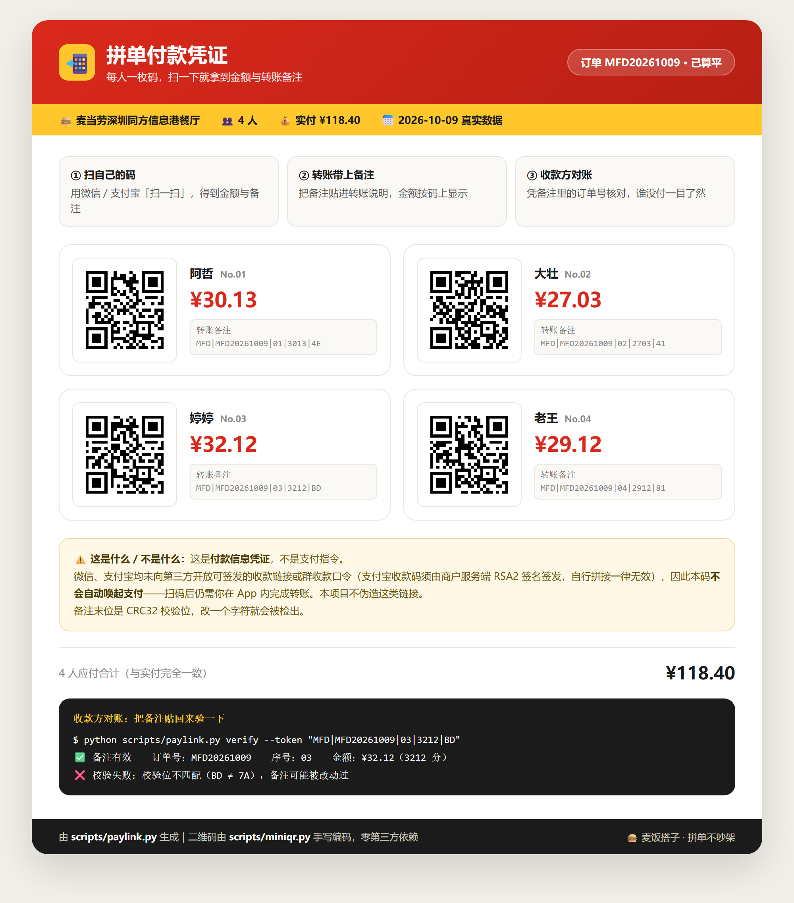

# 🍔 麦饭搭子 · 趣味智能拼单助手

> 拼单不吵架，干饭不纠结，麦门精准组队神器

[]()
[]()
[]()

**适配赛事**：麦当劳程序员创意开发大赛
**开发载体**：WorkBuddy + 麦当劳 MCP 官方接口
**项目仓库**：https://github.com/MX168/maifan-dazi
**双硬性承诺**：
1. **最终方案实付金额永远 ≤ 用户预算**。宁可少点，不可超支。
2. **各人分账金额之和永远精确等于实付金额**。不多收一分，也不少收一分。

---

## 一、它解决什么问题

学生宿舍、职场干饭、朋友拼单时，五件事最烦：

| 痛点 | 麦饭搭子的解法 |
| --- | --- |
| 纠结点餐，众口难调 | 对话式采集全员忌口与偏好，自动过滤 |
| 一不小心超预算 | 预算锁死算法，**零超支是硬约束** |
| 不会用券、不会比价 | 自动比对套餐 vs 单品拼凑，叠加可用券 |
| 不知道吃了多少热量 | 对接官方营养数据，逐人标注与高热量预警 |
| **谁该付多少，算不清就伤感情** | **拼单 AA 分账引擎，按实吃精确到分** |
| **算清楚了，钱还是收不齐** | **每人一张付款码，扫码即得带校验位的转账备注** |

前四件事市面上的点餐工具都在做，第五件几乎没人做——但它才是「拼单不吵架」的真正命门。
一个 ¥43 的套餐和一个 ¥26 的套餐，如果只报一个「人均 ¥32.96」，必然有人默默吃亏。

第六件则是最后一步：账算得再准，钱收不回来也是白搭。所以分账结果会**直接变成可扫的付款码**，
每人扫自己的那张，把备注贴进转账里，收款方凭备注自动对账。

只做工具就太无聊了，所以还加了三个**麦门趣味彩蛋**：干饭人格测试、幸运菜品抽签、省钱战绩海报。

---

## 二、功能一览

### 硬核功能（100% 落地，已跑通）

- **💰 预算锁死智能搭配** —— 在预算内求最优解，输出原价 / 实付 / 人均 / 结余
- **🚫 忌口强制过滤** —— 预设 + 自定义忌口，命中即剔除，并如实汇报剔除了哪些
- **🎟️ 套餐优先比价** —— 自动比对「套餐组合」与「单品拼凑」，套餐省得越多权重越高
- **🔥 热量智能测算** —— 整套总热量、脂肪、蛋白、碳水、钠，逐人标注 + 高热量预警
- **📋 一键复制下单清单** —— 结构化清单，手机端直接复制
- **🧾 拼单 AA 分账** —— 按实吃精确拆账，优惠按比例返还，公共餐品自动均分，**总额分毫不差**
- **📲 一人一码付款凭证** —— 把应付金额编码成二维码，扫码即得**带 CRC32 校验位**的转账备注，收款方凭备注自动对账
- **🔳 零依赖二维码编码器** —— 手写实现 QR Code（ISO/IEC 18004），GF(256) 里德-所罗门纠错、8 种掩码惩罚评分、版本 1~6、纠错等级 L/M/Q/H，**不装任何第三方库**

### 🧾 拼单 AA 分账：为什么它不一样

这是本项目最具差异化的一环，把「拼单不吵架」从口号变成可验证的算法。

| 能力 | 说明 |
| --- | --- |
| **按实吃分摊** | 每人先按自己认领的餐品计价，谁拿得多谁付得多 |
| **优惠按比例返还** | 券省下来的钱按各自金额比例返还，吃得多省得多，而不是平均分 |
| **公共 AA 池** | 大薯条、麦乐鸡、甜品这类大家分的，`--shared` 声明后全员均分；**无人认领的加购小食默认进池** |
| **零头无损** | 整数除不尽的分用**最大余额法**（Hare quota）分配，`各人应付之和 == 实付` |
| **三种模式** | `fair` 按实吃 / `even` 完全平摊（人情局） / `treat` 一人请客 |
| **和气指数** | 极差、标准差 + 每人段位（散财童子 / AA 标兵 / 白嫖新秀…），把账摊开讲 |
| **群收款文案** | 直接复制到微信群，另附**抹零友好版**（抹到整元，差额由收钱方吸收） |

> 关键工程点：金额全程以**分**为单位做整数运算，最后一步才用最大余额法分配尾数。
> 因此不存在「四舍五入累积误差」，`selftest.py` 里用 300 组随机分配验证了这一点。

### 📲 一人一码：从「算清楚」到「付出去」

账算得再准，钱收不回来也是白搭。所以分账结果会进一步变成**每人一张可扫的付款码**。

**先说清楚我们不做什么**：微信支付与支付宝**均未向第三方开放**可签发的群收款口令或收款链接
（支付宝 `https://qr.alipay.com/xxx` 必须由商户服务端 `alipay.trade.precreate` 经 **RSA2 签名**签发，
官方明确说明自行拼接一律无效）。因此本项目**不伪造支付链接**，也不声称「扫码即付款」。

**我们做的是「带校验的付款信息凭证」**：

| 能力 | 说明 |
| --- | --- |
| **备注结构化** | `MFD|<订单号>|<序号>|<金额分>|<CRC32校验位>`，如 `MFD|MFD20261009|03|3212|BD` |
| **可自检** | 末两位是 CRC32 低 8 位的十六进制，**金额被改动会立刻被发现**，不用肉眼核对 |
| **一人一码** | 每人一张独立二维码，扫码即得自己的备注，不用在群里复制来复制去 |
| **可离线校验** | `paylink.py verify --token <备注>` 一条命令判定真伪，退出码 3 表示被篡改 |
| **三种形态** | PNG（可发群）/ SVG（可嵌网页）/ UTF-8 字符画（终端直接显示，无图也能用） |

用法就三步：每人扫自己的码 → 把得到的备注贴进转账备注栏 → 收款方凭备注自动对账。

**为什么二维码要自己写**：项目承诺**零第三方依赖**，而二维码库（`qrcode`、`segno` 等）在评审环境
不一定装得上。所以 `miniqr.py` 用纯标准库实现了 ISO/IEC 18004 的完整编码链路：

```
文本 → UTF-8 字节 → 模式/长度指示符 → 比特流 → 补位 → 分块
     → GF(256) 里德-所罗门纠错码 → 交织 → 矩阵放置（蛇形）
     → 8 种掩码试算 + 惩罚评分选最优 → 格式/版本信息 → 定位/定时/校正图形
```

这不是玩具实现 —— 它经过了**第三方解码器 `jsQR` 的跨语言验证**：

| 验证批次 | 结果 |
| --- | --- |
| 结构表算术一致性（版本 × 纠错等级 × 总码字） | ✅ 内置 `--selftest` 全过 |
| 参考矩阵喂给 jsQR（验证工具链本身可靠） | ✅ 正确解码 |
| 自产矩阵 30 例（L/M/Q/H 四级 × 版本 1~6 × 中文 / URL / 满容量） | ✅ **30/30 通过** |
| 真实落盘的 4 张付款码 PNG 送进 jsQR | ✅ **4/4 通过** |

### 趣味彩蛋（差异化亮点）

- **🎭 麦门干饭人格测试** —— 生成每人标签（炸鸡狂热信徒 / 减脂自律战士 / 堡系原教旨主义者 / 甜品治愈选手…）+ 组队鉴定报告
- **🔮 麦门幸运菜品抽签** —— 随机幸运菜品 + 吉祥文案
- **🏅 省钱战绩海报** —— 立省金额、段位评定，可直接分享
- **🚫 避雷黑名单** —— 永久拉黑某菜品，本地持久化，后续搭配自动过滤

---

## 三、真实演示（数据来自官方 MCP，可复现）

**场景**：职场干饭 · 3 人拼单 · 预算 ¥100 · 全员不吃辣
**门店**：麦当劳深圳同方信息港餐厅（storeCode `1420762`，到店自提）
**数据时间**：2026-10-09



> 上图由 `examples/demo-card.html` 渲染生成，数据源为 `examples/demo_result.json` 与
> `examples/demo_fun_output.md`，**非设计稿或示意图**。

用户看到的最终输出：

```markdown
### 💰 预算与花费
| 项目 | 金额 |
| --- | --- |
| 总预算 | ¥100.00 |
| 原价合计 | ¥148.00 |
| 优惠后实付 | **¥98.90** |
| 预算结余 | ¥1.10 |
| 人均 | ¥32.96（3 人） |

### 🍔 每人一个餐位
| 座位 | 餐品 | 单价 | 热量 |
| --- | --- | --- | --- |
| 1 | 麦香鸡套餐 | ¥28.00 | 369 kcal |
| 2 | 大堡口福三件套 | ¥22.90 | — |
| 3 | 吉士汉堡包套餐 | ¥26.00 | — |

### 🍟 加购小食 / 饮品
| 餐品 | 数量 | 小计 |
| --- | --- | --- |
| 麦麦脆汁鸡1块 | 1 | ¥15.00 |
| 苹果片 | 1 | ¥7.00 |

### 🚫 已自动过滤
- **忌口:辣**：麦辣鸡腿汉堡三件套、麦辣鸡腿汉堡、麦辣鸡翅

### 🔥 热量总览
- 整套合计：**401 kcal**｜脂肪 17.0 g｜蛋白 15.0 g｜碳水 46.0 g｜钠 731 mg
- 单人最高：麦香鸡套餐 369 kcal
- 低脂友好：苹果片

### 📋 一键复制下单清单
麦香鸡套餐  x1
大堡口福三件套  x1
吉士汉堡包套餐  x1
麦麦脆汁鸡1块  x1
苹果片  x1
合计：¥98.90
```

**趣味彩蛋输出**：

```markdown
### 🎭 麦门干饭人格报告
**阿强 —— 炸鸡狂热信徒**
> 阿强的餐盘里没有炸物就不算吃饭，麦门炸鸡事业部终身荣誉会员。

**小美 —— 减脂自律战士**
> 小美在点麦当劳这件事上做到了极致自律，热量表比菜单还熟。

**老王 —— 堡系原教旨主义者**
> 老王坚信「世界的本质是两片面包夹一切」，汉堡区常驻住民。

**组队鉴定**：全员风格各异但目标一致：吃好且不超支，很难不成功。

### 🔮 麦门幸运菜品
今日幸运餐品：**大堡口福三件套**
> 寓意：甜度正好，烦恼减半，收工准点。

### 🏅 省钱战绩海报
【麦饭搭子战绩】3人拼单，预算¥100.00
智能搭配省 ¥49.10！人均 ¥32.96
剩余结余 ¥1.10，麦门省钱达人认证✅

**段位：麦门省钱战神 🏆** —— 这个折扣已经接近极限操作了，请收下膝盖。
```

> 立省 ¥49.10 来自「原价合计 ¥148.00 vs 实付 ¥98.90」，即套餐自身优惠与促销价差额，**非**虚构折扣。该门店当日 `query-store-coupons` 返回为空数组，故券省为 ¥0 —— 项目如实反映，不会编造优惠。

**复现方式**：

```bash
cd examples
python ../scripts/parse_nutrition.py --input nutrition_raw_2026-10-09.txt --out nutrition.json
python ../scripts/planner.py --input demo_request.json --md
python ../scripts/fun.py all --result demo_result.json --persons demo_persons.json --seed 20261009
```

### 🧾 第二个演示：4 人局的 AA 分账

同样是 2026-10-09 的真实门店数据，4 人、预算 ¥120、点了一份加购甜品打算大家分。



> 上图由 `examples/aa-card.html` 渲染，数据来自 `examples/final_output_4p.md`（`scripts/pipeline.py` 端到端产出）。

四个人的实吃金额其实并不一样——婷婷 ¥28.00、老王 ¥25.00、阿哲 ¥26.00、大壮 ¥22.90。
如果只报「人均 ¥29.60」，婷婷白吃、大壮吃亏。分账引擎给出的是：

| 成员 | 认领餐品 | 公共均摊 | **应付** | 与人均差 |
| --- | --- | --- | --- | --- |
| 阿哲 | ¥26.00 | ¥4.13 | **¥30.13** | +1.8% |
| 大壮 | ¥22.90 | ¥4.13 | **¥27.03** | -8.7% |
| 婷婷 | ¥28.00 | ¥4.12 | **¥32.12** | +8.5% |
| 老王 | ¥25.00 | ¥4.12 | **¥29.12** | -1.6% |
| **合计** | | | **¥118.40** | **== 实付** |

几个值得注意的细节：

- **公共池除不尽**：蓝莓爆爆珠麦旋风 ¥16.50 由 4 人均分，每人应为 ¥4.125 —— 引擎给出 ¥4.13 / ¥4.13 / ¥4.12 / ¥4.12，合计恰好 ¥16.50。
- **群收款文案**可直接复制到微信群，另附**抹零友好版**（¥30.40 / ¥27.00 / ¥32.00 / ¥29.00），差额 ¥0.40 由收钱方补齐。
- **和气指数 91/100（🕊️ 和气生财）**：极差仅 ¥5.09，标准差 ¥1.83。

**复现方式**：

```bash
python scripts/pipeline.py \
    --request examples/demo_request_4p.json \
    --nutrition-raw examples/nutrition_raw_2026-10-09.txt \
    --persons examples/demo_persons_4p.json \
    --seed 20261009 --round-yuan \
    --out examples/final_output_4p.md
```

### 📲 第三个演示：一人一码的付款凭证

把上面那局 4 人的分账结果直接编码成付款码：



> 上图由 `examples/pay-card.html` 渲染，图片素材为 `examples/pay/pay_01~04.png`
> （`scripts/paylink.py` 的真实产出，非设计稿）。

| 序号 | 成员 | 应付 | 转账备注 |
| --- | --- | --- | --- |
| 01 | 阿哲 | **¥30.13** | `MFD\|MFD20261009\|01\|3013\|4E` |
| 02 | 大壮 | **¥27.03** | `MFD\|MFD20261009\|02\|2703\|41` |
| 03 | 婷婷 | **¥32.12** | `MFD\|MFD20261009\|03\|3212\|BD` |
| 04 | 老王 | **¥29.12** | `MFD\|MFD20261009\|04\|2912\|81` |
| | **合计** | **¥118.40** | **== 实付** |

四张码已用第三方解码器 `jsQR` 实际扫描验证，**4/4 全部扫出正确备注**：

```
[OK]   pay_01.png  1272x1272  ->  MFD|MFD20261009|01|3013|4E
[OK]   pay_02.png  1272x1272  ->  MFD|MFD20261009|02|2703|41
[OK]   pay_03.png  1272x1272  ->  MFD|MFD20261009|03|3212|BD
[OK]   pay_04.png  1272x1272  ->  MFD|MFD20261009|04|2912|81

结果: 4/4 通过
```

校验位是怎么挡住篡改的：

```bash
# 正常备注
$ python scripts/paylink.py verify --token "MFD|MFD20261009|03|3212|BD"
✅ 备注有效
   订单号：MFD20261009
   序　号：03
   金　额：¥32.12（3212 分）                       # exit code 0

# 把金额从 3212 改成 0900，想少付 ¥23.12
$ python scripts/paylink.py verify --token "MFD|MFD20261009|03|0900|BD"
❌ 校验失败：校验位不匹配（BD ≠ DF），备注可能被改动过   # exit code 3
```

> 括号里前者是备注上写的校验位，后者是按内容重算出来的应有值。
> 两者不一致即判定被篡改，脚本以退出码 3 退出，可直接串进 Shell 脚本做批量对账。

**复现方式**：

```bash
# 生成 4 张付款码 PNG + Markdown 凭证
python scripts/paylink.py gen \
    --split examples/pay_split_4p_out.json \
    --order-id MFD20261009 \
    --outdir examples/pay \
    --out examples/pay_output.md
```

---

## 四、项目结构

```
maifan-dazi/
├── SKILL.md                        # Skill 主文档（WorkBuddy 加载入口）
├── README.md                       # 本文件
├── SUBMISSION_ISSUE.md             # 报名 Issue 文案（可直接复制提交）
├── MCP_INTEGRATION.md              # MCP 接口对接详细说明（官方指定文件名）
├── CONTEST_DECLARATION.md          # 大赛官方原版声明（内容未改动）
├── mcp-config.example.json         # 脱敏 MCP 配置示例（仅环境变量占位符）
├── workbuddy.md                    # 运行环境说明与功能适配证明
├── PROJECT_DECLARATION.md          # 项目自主声明（补充说明，非官方要求）
├── LICENSE                         # MIT 开源许可
├── .gitignore                      # 防止令牌等敏感文件被提交
├── scripts/
│   ├── planner.py                  # 预算锁死搭配算法（核心）
│   ├── split.py                    # 拼单 AA 分账引擎（差异化核心）
│   ├── paylink.py                  # 付款凭证生成器（备注 + CRC32 校验 + 出码）
│   ├── miniqr.py                   # 零依赖二维码编码器（ISO/IEC 18004）
│   ├── parse_nutrition.py          # 营养接口原始数据解析
│   ├── fun.py                      # 人格 / 幸运菜品 / 战绩海报
│   ├── profile.py                  # 避雷清单与口味档案（本地持久化）
│   ├── pipeline.py                 # 端到端编排（一条命令跑完）
│   └── selftest.py                 # 边界用例自测（70 项）
├── references/
│   ├── mcp-api.md                  # MCP 参数对照与踩坑清单
│   └── dietary-rules.md            # 忌口与偏好关键词词表
├── connector/
│   ├── mcd-mcp.example.json        # 连接器配置示例（令牌为占位符）
│   └── README.md                   # 接入方式与安全提醒
└── examples/
    ├── nutrition_raw_2026-10-09.txt# 官方营养接口原始返回
    ├── nutrition.json              # 解析后的营养数据
    ├── demo_3p_100yuan.json        # 演示用菜单（真实价格）
    ├── demo_request.json           # 完整请求入参（3 人）
    ├── demo_request_4p.json        # 完整请求入参（4 人）
    ├── demo_persons.json           # 演示用成员偏好（3 人）
    ├── demo_persons_4p.json        # 演示用成员偏好（4 人）
    ├── demo_result.json            # 演示方案输出
    ├── demo_output.md              # 方案 Markdown 报告
    ├── demo_fun_output.md          # 趣味彩蛋输出
    ├── final_output.md             # 端到端最终输出（3 人，含 AA 分账）
    ├── final_output_4p.md          # 端到端最终输出（4 人，含公共池与抹零）
    ├── pay_split.json              # 分账结果（3 人）
    ├── pay_split_4p.json           # 分账请求（4 人）
    ├── pay_split_4p_out.json       # 分账结果（4 人）
    ├── pay_output.md               # 付款凭证 Markdown（含字符画二维码）
    ├── pay/pay_01~04.png           # 4 张真实付款码（已通过 jsQR 解码验证）
    ├── demo-card.html / .png       # 效果卡（拼单方案）
    ├── aa-card.html / .png         # 效果卡（AA 分账）
    └── pay-card.html / .png        # 效果卡（一人一码付款凭证）
```

---

## 五、快速开始

### 端到端一键跑通（最快验证）

```bash
python scripts/pipeline.py \
    --request examples/demo_request.json \
    --nutrition-raw examples/nutrition_raw_2026-10-09.txt \
    --persons examples/demo_persons.json \
    --seed 20261009 \
    --out examples/final_output.md
```

一条命令完成「营养解析 → 搭配算法 → 趣味彩蛋 → AA 分账 → 最终 Markdown」。

### 单独跑一次 AA 分账

```bash
# 按实吃分摊（默认）
python scripts/split.py --result examples/demo_result.json --persons examples/demo_persons.json

# 人情局：完全平摊
python scripts/split.py --result examples/demo_result.json --persons examples/demo_persons.json --mode even

# 一人请客
python scripts/split.py --result examples/demo_result.json --persons examples/demo_persons.json --mode treat --payer 老王

# 声明公共餐品 + 额外给一版抹零金额
python scripts/split.py --result examples/demo_result.json --persons examples/demo_persons.json \
    --shared "麦麦脆汁鸡1块" --shared 苹果片 --round-yuan

# 机器可读输出（含 sum_check 自校验字段）
python scripts/split.py --result examples/demo_result.json --persons examples/demo_persons.json --json
```

### 生成付款码（一人一码）

```bash
# 出 PNG + Markdown 凭证（推荐）
python scripts/paylink.py gen \
    --split examples/pay_split_4p_out.json \
    --order-id MFD20261009 \
    --outdir examples/pay \
    --out examples/pay_output.md

# 也可以直接从搭配结果算起（内部先跑一遍分账）
python scripts/paylink.py gen \
    --result examples/demo_result.json --persons examples/demo_persons.json \
    --order-id MFD20261009 --outdir examples/pay

# 只在终端看，不出图
python scripts/paylink.py gen --split examples/pay_split_4p_out.json --order-id MFD20261009

# 校验一条备注（退出码 3 = 备注被改动过）
python scripts/paylink.py verify --token "MFD|MFD20261009|03|3212|BD"
```

单独画一张二维码：

```bash
python scripts/miniqr.py --text "MFD|MFD20261009|03|3212|BD" --level M --out qr.png
python scripts/miniqr.py --text "麦门永存" --utf8      # 终端字符画，无图环境也能用
python scripts/miniqr.py --selftest                    # 校验内部版本/纠错表
```

### 跑一遍自测（70 项边界用例）

```bash
python scripts/selftest.py                # 全部
python scripts/selftest.py --only split   # 只跑分账
python scripts/selftest.py --only paylink # 只跑付款凭证
python scripts/selftest.py --only qr      # 只跑二维码
```

### 作为 WorkBuddy Skill 使用（推荐）

1. 把 `maifan-dazi/` 整个目录放到 `~/.workbuddy/skills/`（或导入随包分发的 `maifan-dazi-skill-*.zip`）
2. 在 WorkBuddy 中启用**麦当劳 MCP 连接器**
3. 对话里直接说：「3 个人，预算 100，不吃辣，帮我拼个麦当劳」

### 直接命令行调用

```bash
# 1. 先载入本地档案，看看之前存过什么偏好
python scripts/profile.py show

# 2. 组装请求骨架（自动带上避雷清单和历史偏好）
python scripts/profile.py collect --headcount 3 --budget 10000 > request.json

# 3. 把 MCP 拉到的 menu / nutrition / coupons 填进 request.json，然后跑算法
python scripts/planner.py --input request.json --out result.json

# 4. 生成趣味彩蛋
python scripts/fun.py all --result result.json --persons persons.json

# 5. 多人拼单时算分账（谁该付多少）
python scripts/split.py --result result.json --persons persons.json
```

**环境要求**：Python 3.8+，**仅用标准库**，无第三方依赖，无需本地服务器与数据库。

---

## 六、算法说明（预算锁死是怎么保证的）

搭配不是靠大模型口算，而是交给 `planner.py` 的确定性算法 —— 这是「零超支」能被保证的前提。

**候选过滤**：按忌口关键词与避雷清单，对餐品名称与标签做子串匹配，命中即剔除，并记录剔除原因回报给用户。

**搜索**：以「最便宜主食填满人数」等多个起点做爬山搜索，每轮评估四类动作：

| 动作 | 说明 |
| --- | --- |
| `swap` | 替换某个餐位 |
| `add` / `reswap` | 加购或替换小食饮品 |
| `drop` | 删掉冗余餐位 |
| `combo` | **用一个多人份套餐整组替换若干餐位**（套餐优先） |

**评分函数**：

```
score = Σ 餐品基础分          # 套餐 12 / 主食 10 / 小食 4 / 饮料 3 / 甜品 3.5
      + 套餐额外分            # +2 且每省 ¥5 再 +1，让套餐在比价中占优
      + 0.8 × 不重复 SKU 数   # 鼓励口味多样
      - 1.5 × 同款重复份数    # 抑制批发式点单
      + 3.0 × 偏好命中份数
      - 20 × 多出的用餐份额   # 严禁为了花满预算而多点
      - 6 × (剩余预算 / 总预算)
```

**三条硬约束**（在评分里直接返回 `-∞`，不可能被违反）：

1. 总价 > 预算 → 否决
2. 总份额 < 人数 → 否决（必须喂饱每个人）
3. 总件数 > `max(人数+1, 1.8×人数)` → 否决

若最省方案仍超出预算，算法**不会偷偷超支**，而是返回明确的缺口金额，交由用户决策。

### 分账是怎么保证分毫不差的

分账看起来只是除法，但真做起来有两个陷阱：**优惠该归谁**，以及**除不尽的零头**。

**第一步：认领**。把 planner 输出的餐品摊平成「餐品单位」列表。这里有个容易踩的坑——`extra_items` 是**逐单位重复**的列表（同一餐品买 2 份就出现 2 次），因此每个元素就是一个单位，绝不能再乘它的 `qty` 字段，否则会重复计价。公共餐品（`--shared`）与无人认领的加购小食归入 AA 池。

**第二步：定权重**。每人权重 = 自己认领餐品金额 + 公共池均分份额。公共池用最大余额法在全员间均分，因此池内除不尽的 1 分也有明确归属。

**第三步：按比例摊到实付**。以权重为比例，把**实付金额**（而非原价）拆给每个人 —— 订单优惠天然按比例返还，吃得多省得多，而不是平均分。

**第四步：最大余额法收尾**。这是全流程的关键：

```python
exact = [total * w / sum(w) for w in weights]   # 精确份额
base  = [floor(e) for e in exact]               # 先取整
frac  = [e - b for e, b in zip(exact, base)]    # 小数部分
# 剩余的「分」按小数部分从大到小派发，权重相同则按原顺序
```

因为取整只会向下丢分，丢失总量必然 < 人数，所以按小数部分补齐即可精确闭合。
`selftest.py` 用 **300 组随机分配**验证了「总和精确且非负」，另有除不尽、权重全 0、总额为 0 等边界。

最终结果由脚本输出 `sum_check` 字段自校验：`sum(各人应付) == 实付`。

### 付款码是怎么保证「扫得出来」的

二维码最大的坑是：**画出来看着像，扫不出来**。位图人眼分辨不出对错，只有解码器能判。
所以这一块的正确性不靠自查，靠**跨语言验证**——Python 编码，Node 的 `jsQR` 解码。

`miniqr.py` 完整实现了 ISO/IEC 18004 的编码链路，其中三个地方最容易写错（本项目都踩过并修复）：

| 坑 | 错在哪 | 后果 |
| --- | --- | --- |
| **RS 生成多项式因子方向** | 单因子 `(x + α^i)` 按「低次在前」应写 `[α^i, 1]`，写成 `[1, α^i]` 得到的是 `(1 + α^i·x)` | 纠错码全错，**整盘无法解码** |
| **绘制顺序** | 必须先画定时图形，再画定位图形 | 第 6 行/列的定时图形会把三个定位图形边框整格覆盖，定位失败 |
| **纠错等级指示符位数** | 是 **2 位**：L=`01` M=`00` Q=`11` H=`10` | 写成 4 位的 `0x11`/`0x10`，L/M 恰好没暴露问题，**Q/H 全部扫不出** |

修复过程是靠「伴随式（syndrome）检验」定位的：把码字多项式代入 `α^0..α^(n-1)` 求值，
全为 0 才是合法 RS 码字。**注意 Horner 求值必须从最高次项开始**——从最低次开始会得到错误结论，
我第一版验证脚本就是这么写的，结果误判成「没问题」。

最终验证覆盖：

- 版本 1~6 × 纠错等级 L/M/Q/H，共 30 例自产矩阵 → jsQR **30/30 通过**
- 真实落盘的 4 张付款码 PNG（原图 264×264，放大到 1272×1272 模拟摄像头）→ jsQR **4/4 通过**
- 数据结构含中文、URL、满容量字节，均正常解码

### 校验位是怎么挡住篡改的

备注末两位是 `CRC32(前缀) & 0xFF` 的十六进制大写形式：

```python
def checksum(prefix: str) -> str:
    return "%02X" % (zlib.crc32(prefix.encode("utf-8")) & 0xFF)
```

收款方收到转账后，把备注丢给 `paylink.py verify` 即可判定真伪。
金额只要被改一个数字，校验位就对不上，脚本以**退出码 3** 报错并指出期望值与实际值。
这让「口头报账」变成了**可机检的事实**，而不需要收款方自己心算。

---

## 七、核心技术亮点

| 亮点 | 说明 |
| --- | --- |
| **零超支是硬约束** | 金额由确定性脚本计算，不依赖大模型口算；超预算方案在评分阶段即被否决 |
| **真实数据驱动** | 菜单、价格、营养全部来自官方 MCP 实时接口，无任何硬编码菜单 |
| **官方营养接口的坑已填** | `list-nutrition-foods` 返回的是**纯文本表格**而非 JSON，字段名也与常规命名不同，本项目写了专用解析器 |
| **套餐比价不是口号** | 套餐优惠额直接进入评分函数，「优先最优解」是可验证的 |
| **降级不崩溃** | 忌口过重导致主食全被过滤时自动降级为拆单品组合；预算不足时明确报缺口 |
| **分账金额分毫不差** | 全程以「分」做整数运算，尾数由最大余额法分配，`各人应付之和 == 实付` 有 300 组随机用例兜底 |
| **手写了二维码编码器** | 零依赖实现 ISO/IEC 18004（GF(256) RS 纠错 + 掩码惩罚评分），并用第三方解码器 jsQR 跨语言验证 30/30 + 真实 PNG 4/4 |
| **转账备注可机检** | CRC32 校验位让「少报金额」当场暴露，`verify` 子命令以退出码 3 判伪，不依赖肉眼核对 |
| **不伪造支付能力** | 微信/支付宝均未开放第三方签发，本项目明确声明「不是支付指令」，只做信息凭证 |
| **轻量可落地** | 纯标准库、无数据库、无需部署，Skill 形式直接可用 |

---

## 八、适配场景

宿舍拼单 · 职场干饭 · 朋友聚餐 · 单人解馋 · 亲子用餐 · 企业团餐

支持 1-10 人，覆盖到店自提、得来速、麦乐送外送、企业团餐四种取餐渠道。

---

## 九、风险与应对

| 风险 | 应对 |
| --- | --- |
| MCP 接口波动 | 异常捕获 + 友好提示；同时给出经典套餐备选（不含具体金额，避免误导） |
| 预算极低无匹配 | 明示缺口金额 + 最低可行方案，交由用户决策，**绝不偷偷超支** |
| 忌口过多无套餐 | 自动降级拆单品，优先满足忌口 |
| 门店无可用券 | 如实展示券省为 ¥0，不编造优惠 |
| 活动更新迭代 | 动态拉取实时活动，无需改代码 |
| 有人没认领餐品 | 加购小食自动进公共 AA 池均分；主食按座位顺序兜底分配 |
| 认领了菜单里没有的餐品 | 如实回报「已忽略」，不静默吞掉 |
| 分账除不尽 | 最大余额法分配尾数，另给一版抹零金额供真人转账 |
| 备注超长装不进二维码 | 自动升版本（1~6），仍装不下则明确报错，绝不静默截断 |
| 二维码扫不出来 | 用第三方解码器 jsQR 做跨语言回归验证；另提供 UTF-8 字符画形态兜底 |
| 有人少报转账金额 | CRC32 校验位当场判伪，`verify` 退出码 3 |
| 误以为扫码会自动付款 | 凭证顶部固定展示免责说明，明确「不是支付指令」 |

---

## 十、路线图

- [x] 基础信息对话采集
- [x] 预算锁死搭配算法
- [x] 忌口过滤 + 避雷清单
- [x] 优惠券匹配
- [x] 热量测算
- [x] 三个趣味彩蛋
- [x] 拼单 AA 分账（按实吃 / 平摊 / 请客 + 公共池 + 抹零版）
- [x] 一人一码付款凭证（零依赖二维码 + CRC32 校验备注，jsQR 验证 30/30 + 4/4）
- [ ] 麦门人格海报的图片化输出
- [ ] 常用组合一键复用（基于 `profile.py` 的历史记录）
- [ ] 多人份餐品份额的自动识别（当前依赖调用方传 `serves`）
- [ ] 真正的群收款口令 —— **取决于平台开放**：微信/支付宝目前均未向第三方开放签发能力，
      官方明确不可自行拼接收款链接。一旦开放即可直接替换 `build_payload()`，其余链路无需改动

---

## 十一、赛事提交文件清单

依据官方仓库 `M-China/mcd-developer-innovation-challenge` 的《活动规则》「开发与发布项目」一节：

| 文件 | 官方说明 | 是否必须 | 状态 |
| --- | --- | :-: | --- |
| `README.md` | 项目介绍、安装方法、使用示例、目标用户 | 必须，文件名不可改动 | ✅ 已完成 |
| `CONTEST_DECLARATION.md` | 参赛声明（原创性、合规性、敏感信息） | **必须，文件名及内容均不可改动** | ✅ 已使用官方原版，未改动 |
| `MCP_INTEGRATION.md` | 实际使用的 MCP Server、Tool、调用流程和业务价值 | 必须，文件名不可改动 | ✅ 已完成 |
| `mcp-config.example.json` | 脱敏后的 MCP 配置示例，只允许环境变量占位符 | 必须 | ✅ 已完成 |
| `workbuddy.md` | WorkBuddy 对话上下文（参与专项奖励时必须） | 非必须；参与 WorkBuddy 专项奖励时必须 | ✅ 已完成 |
| 源代码 | 项目主体代码或可运行内容 | 必须，形式不限 | ✅ 已完成 |
| `LICENSE` | 开源许可（MIT），非官方要求 | — | ✅ 已完成 |
| `PROJECT_DECLARATION.md` | 项目自主声明（补充说明），非官方要求 | — | ✅ 已完成 |
| `SUBMISSION_ISSUE.md` | 报名 Issue 文案（1000 字内、无图），非官方要求 | — | ✅ 已完成 |

> 说明：代码采用 MIT 许可。麦当劳相关商标、品牌名称、餐品名称的权利归其权利人所有，
> 本项目仅作技术实现展示，不主张任何商标权益。

## 十二、报名与评审须知（官方规则要点）

- **活动时间**：2026-10-09 10:30 至 2026-10-25 23:59（北京时间）
- **定榜时间**：2026-10-26 00:00 采集的公开 Star 数
- **项目创建时间**：须在 2025-12-25 00:00 至 2026-10-25 23:59 之间
- **排名依据**：GitHub 公开 **Star 数**，Star 数为 0 不进入排行榜，原则上前 100 名进榜
- **报名方式**：在官方仓库按模板发布 Issue，正文格式如下且**不超过 1000 字、不含图片**：

  ```text
  【参赛申请】
  项目名称：麦饭搭子 · 趣味智能拼单助手
  项目地址：https://github.com/MX168/maifan-dazi
  项目简介：……
  ```

  完整简介文案见 [SUBMISSION_ISSUE.md](./SUBMISSION_ISSUE.md)，已控制在 1000 字内、不含图片，可直接复制。

- **仓库必须 Public**，否则无法通过报名审核

## 十三、相关文档

- [MCP_INTEGRATION.md](./MCP_INTEGRATION.md) —— MCP 接口对接流程与技术原理
- [CONTEST_DECLARATION.md](./CONTEST_DECLARATION.md) —— 大赛官方原版参赛声明
- [PROJECT_DECLARATION.md](./PROJECT_DECLARATION.md) —— 项目自主声明与提交前检查清单
- [workbuddy.md](./workbuddy.md) —— 运行环境说明与功能适配证明
- [connector/README.md](./connector/README.md) —— 连接器接入与安全提醒
- [references/mcp-api.md](./references/mcp-api.md) —— 参数对照表与踩坑清单
- [references/dietary-rules.md](./references/dietary-rules.md) —— 忌口与偏好关键词词表
- [SKILL.md](./SKILL.md) —— Skill 主文档

---

**项目名称**：麦饭搭子 · 趣味智能拼单助手
**Slogan**：拼单不吵架，干饭不纠结，麦门精准组队神器
